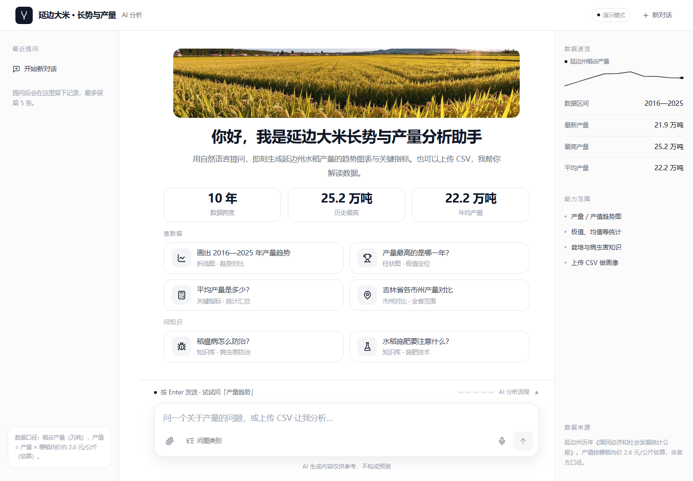
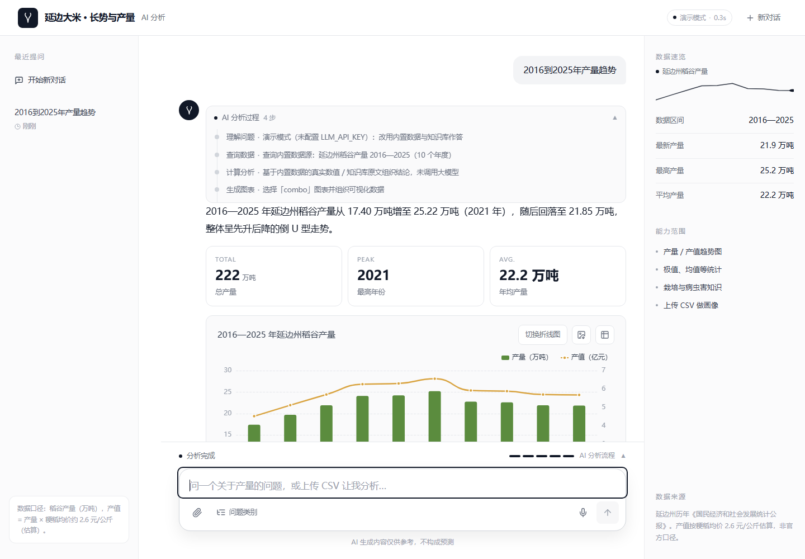
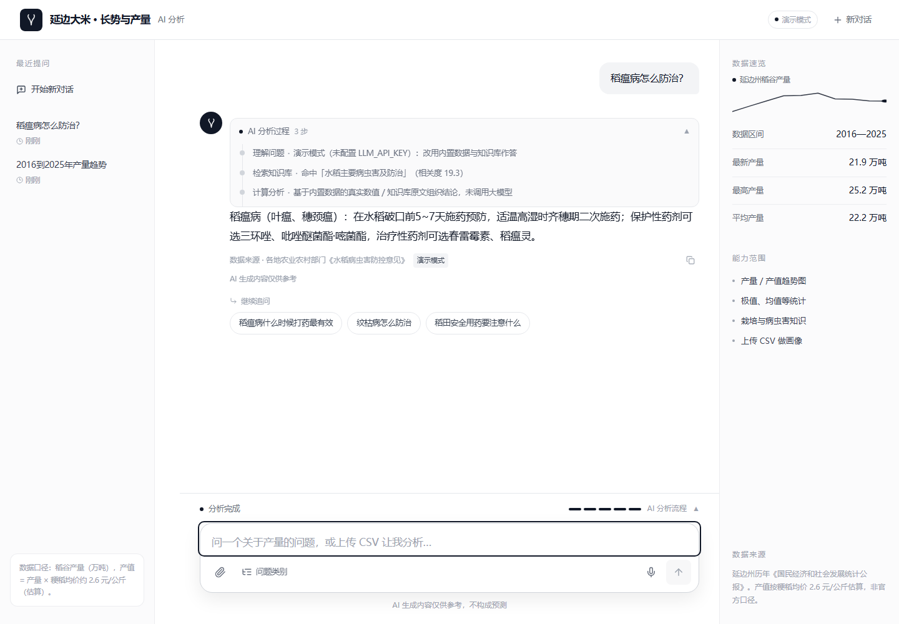
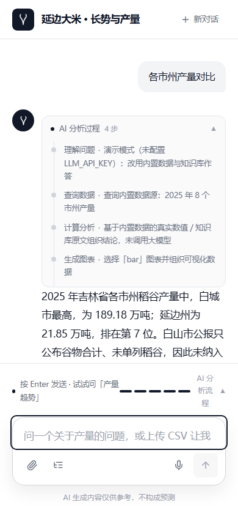
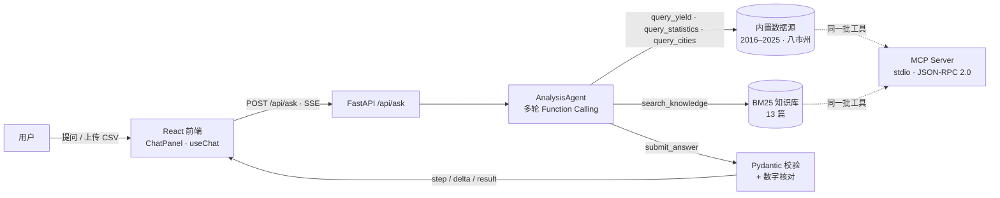

# 延边大米 · 长势与产量 AI 数据分析平台

> 用一句中文问话，拿到延边州水稻的产量趋势、统计结论和农技答案。
> 数字来自工具查询而不是模型编造，知识来自本地知识库并标注出处。

**赛项**：全国高校 AI Web 开发挑战赛 · 省赛 · AI 数据分析与可视化方向（命题方向 8）
**学校 / 组别**：延边职业技术学院 / C 组（高职高专院校）
**作品形态**：AI Native Web 应用（React + FastAPI + 大模型）

---

## 一、为什么做

延边是吉林省水稻主产区，也是典型的冷凉稻区。数据每年都在统计公报里公布，但农户要用起来有三道坎：

1. **要找得到**：公报散在省、州、市各级网站，年份、口径各不相同；
2. **要算得清**：同比、均值、峰值、全省排名，得自己抄表算；
3. **要看得懂**：农技知识散在省厅与县站的文件里，「什么时候打药」「水放多深」全靠打电话或凭经验。

这个项目把三件事收进一个对话框：**数据可查、结论可算、知识可溯**。

## 二、能做什么

| 场景 | 示例问法 | 产出 |
|---|---|---|
| 产量趋势 | 「2016—2025 年产量趋势」 | 折线/组合图 + 峰值、年均值等 KPI |
| 极值统计 | 「哪一年产量最高」「平均产量是多少」 | 柱状图/折线图 + 结论 |
| 省市对比 | 「吉林省各市州产量对比」「延边排第几」 | 八市州柱状图 + 排名说明 |
| 产值口径 | 「稻谷产值怎么估算的」 | 产值曲线 + 口径说明（估算，非官方销售额） |
| 农技知识 | 「稻瘟病怎么防治」「插秧后水层多深」 | 知识库原文摘录 + 来源标注 |
| 文件分析 | 上传 CSV（≤5MB） | 本地数据画像 + 图表/表格；有密钥时交由 AI 解读 |
| 交互 | 图表点选、推荐追问、语音提问、导出 PNG/CSV | 追问式分析闭环 |

### 界面预览

| 首页：示例问题与数据概览 | 数据问答：结论 + KPI + 图表 |
|---|---|
|  |  |

| 知识问答：知识库原文 + 来源标注 | 移动端（390px） |
|---|---|
|  |  |

## 三、快速开始

**方式一：双击 `一键启动.bat`**（推荐给评审）

脚本会自动检查端口、复制 `.env.example`、安装依赖、隐藏窗口启动前后端，并打开 <http://localhost:5173>。

**方式二：手动启动**

```bash
# 后端
cd 后端
python -m venv .venv
.venv\Scripts\activate          # macOS/Linux: source .venv/bin/activate
pip install -r requirements.txt
Copy-Item .env.example .env     # 填 LLM_API_KEY 即为真实 AI；留空为演示模式
uvicorn app.main:app --port 8000

# 前端（另开一个终端）
cd 前端
npm install
npm run dev
```

环境要求：Python 3.10+、Node.js 18+。后端接口文档在 <http://127.0.0.1:8000/docs>。

`一键启动.bat` 同时支持两个子命令（在项目根目录打开命令行执行）：

```bat
一键启动.bat          :: 启动前后端并打开浏览器
一键启动.bat stop     :: 停止 8000 / 5173 上的服务
一键启动.bat pack     :: 生成不含 .env、.venv、node_modules 的交付压缩包
```

服务在隐藏窗口运行，日志写入 `logs\backend.log` 与 `logs\frontend.log`。

## 四、系统架构



- **前端**：React 18 + TypeScript + Vite + Tailwind CSS v4 + ECharts（按需引入、懒加载）
- **后端**：FastAPI + Pydantic v2，唯一接口 `POST /api/ask`（JSON / SSE）
- **模型**：DeepSeek（OpenAI 兼容协议），Function Calling
- **检索**：BM25 稀疏检索，纯标准库实现（中文单字 + 双字 bigram）
- **工具协议**：Function Calling 主链路 + 独立 MCP Server，两条链路共用同一数据口径

## 五、AI 技术方案

1. **不让模型碰数字。** 产量、产值、统计量全部通过 `query_yield` / `query_statistics` / `query_cities` 查询数据源，模型只负责组织语言；回答里出现的吨位数字还会做一次核对，必须能追溯到工具返回值。
2. **结构化输出。** 模型必须通过 `submit_answer` 工具提交结果，字段与枚举受 Pydantic 白名单约束；校验失败自动注入纠错提示重试一次，仍失败降级为纯文字回答，不会把 500 抛给用户。
3. **RAG 检索增强。** 内置 13 篇延边水稻知识库（栽培、施肥、病虫害、农时、品种、补贴），BM25 检索 + 口语查询改写（「打药」→「防治 药剂」）。30 条真实问法评测：Recall@1 30/30，关闭改写后 Recall@1 下降 6.7 个百分点。
4. **可解释轨迹。** SSE 逐条下发 `step` 事件（理解问题 → 查询数据 → 计算分析 → 生成图表），前端「AI 分析流程」面板展示真实的工具名与调用参数，而不是装饰动画。
5. **MCP 工具集成。** `后端/mcp_server.py` 用纯标准库实现 MCP over stdio，把同一批工具暴露给 Claude Desktop、IDE 插件等任意 MCP 客户端，与 Web 链路共享数据口径。
6. **安全与兜底。** CSV 内容按「数据区/指令区」隔离，防提示词注入；接口入参限长（问题 ≤500 字、历史 ≤6 轮、CSV 句柄限行）；错误统一归一化，不向用户暴露堆栈。
7. **真流式。** 最终答案是工具参数里的 JSON，流式时分片到达；项目实现了增量解析器，边收边把 `summary` 抠出来下发。配置真实密钥时实测一次数据类回答约 300 个片段、首末跨度约 1.3 秒（复跑：`后端/tools/stream_check.py`）。

## 六、演示模式（没有密钥也能完整演示）

`.env` 里不填 `LLM_API_KEY` 时进入**演示模式**：不调用大模型，但回答仍然**按问题类型**生成——

- 数据类问题 → 查内置数据源，出图出结论；
- 病虫害/栽培/政策类问题 → 检索内置知识库，按原文摘录作答并标来源；
- 寒暄、范围外问题 → 说明能力边界，不硬套产量图。

界面会标注「演示模式」，顶栏也不会显示模型名。这是有意的降级设计：第一次拿到项目的人不填密钥也能完整走通流程。

## 七、目录结构

```
延边大米种植长势与产量 AI 数据分析可视化平台/
├── 一键启动.bat                  # 唯一的入口脚本：启动 / 停止 / 打包
├── 前端/                         # React + TS 单页应用
│   ├── src/components/           # 对话、图表、轨迹、输入、侧栏等展示组件
│   ├── src/hooks/useChat.ts      # 唯一的数据编排入口
│   ├── src/api/                  # 请求封装（fetch + SSE 解析 + 错误归一化）
│   ├── src/utils/                # 校验、CSV 解析、图表配置、导出、KPI
│   └── public/                   # logo、hero 图
├── 后端/                         # FastAPI 服务
│   ├── app/api/routes/ask.py     # POST /api/ask（JSON / SSE）
│   ├── app/services/agent.py     # Agent 编排（多轮工具调用 + 兜底）
│   ├── app/services/demo.py      # 演示模式应答器
│   ├── app/services/rag/         # BM25 检索器 + 13 篇知识库
│   ├── app/schemas.py            # 数据契约（前后端唯一权威）
│   ├── app/tools.py              # Function Calling 工具注册表
│   ├── mcp_server.py             # MCP Server（stdio）
│   ├── tests/                    # 48 项单元测试
│   └── tools/                    # rag_eval（检索评测）、stream_check（流式实测）
├── docs/
│   ├── 延边大米-AI数据分析平台-技术文档.pdf
│   ├── 延边大米-AI数据分析平台-技术文档.docx
│   └── screenshots/              # README 引用的界面截图
└── README.md
```

## 八、环境变量

复制 `后端/.env.example` 为 `后端/.env`：

| 变量 | 默认值 | 说明 |
|---|---|---|
| `LLM_BASE_URL` | `https://api.deepseek.com/v1` | OpenAI 兼容端点 |
| `LLM_API_KEY` | 空 | 留空即演示模式 |
| `LLM_MODEL` | `deepseek-chat` | 模型名 |
| `LLM_TEMPERATURE` | `0.2` | 采样温度 |
| `LLM_MAX_TOKENS` | `2048` | 单次回答上限 |
| `LLM_TIMEOUT_SECONDS` | `20` | 单次调用超时 |
| `CORS_ORIGINS` | 本地 5173 | 放行的前端来源（线上演示改成你的域名） |

前端只有一个变量：`VITE_API_BASE_URL`（默认 `http://127.0.0.1:8000`）。

`.env` 已被 `.gitignore` 排除，代码里不含任何密钥。

## 九、测试与自检

| 命令 | 覆盖内容 | 当前结果 |
|---|---|---|
| `后端: pytest` | Agent 编排、工具、RAG、Schema 校验、安全回归、演示模式、MCP | 48 passed |
| `前端: npm test` | KPI 计算、单位口径、响应校验、演示兜底、图表系列名、数据抽稀 | 18 passed |
| `前端: npm run typecheck` | TypeScript 严格模式 | 通过 |
| `前端: npm run build` | 生产构建（ECharts 单独分包 + 懒加载） | 通过 |
| `后端: tools/rag_eval.py` | 30 条真实问法的 Recall@1/@3 | 30/30、30/30 |
| `后端: tools/stream_check.py` | 流式片段数与首末跨度 | 需真实密钥；演示模式会明确标注 |

## 十、数据来源与口径

| 数据 | 来源 | 口径 |
|---|---|---|
| 延边州稻谷产量 2016–2025 | 延边州历年《国民经济和社会发展统计公报》 | 万吨 |
| 吉林省八市州产量（2025） | 各市州 2025 年统计公报 | 万吨；白山市未单列稻谷，不纳入 |
| 产值 | 产量 × 粳稻均价约 2.6 元/公斤 | **估算值**，非官方「销售额」 |
| 农技知识 | 吉林省农业农村厅、农业农村部、全国农技中心、延边州与汪清县官方发布 | 逐条标注来源 |

局限：数据为年度口径，不含实时农情、气象与县域细分；需求量更大的场景可替换 `DataSource` 实现接入数据库或统计局 API，工具层无需改动。

## 十一、常见问题

- **端口被占用 / 重复启动**：在项目根目录执行 `一键启动.bat stop`，再双击启动。
- **回答旁有「演示模式」**：说明没填 `LLM_API_KEY`，回答由内置数据与知识库生成，不是故障。
- **语音按钮没出现**：Firefox 不支持 Web Speech API，换 Chrome / Edge。
- **导出没反应**：检查浏览器是否拦截了自动下载。
- **上传 CSV 报错**：仅支持 `.csv`、单文件 ≤5MB；解析在浏览器本地完成，会把前 2000 行交给后端分析。
- **长问题发不出去**：问题上限 500 字，输入框会自动截断。

隐私：对话与 CSV 只发往**本机后端**；配置密钥时，问题与前 2000 行数据会随请求发送到你所配置的大模型服务；不写入数据库，访问日志只记录路径、状态码与耗时。

## 十二、团队信息

| 项 | 内容 |
|---|---|
| 学校 | 延边职业技术学院 |
| 组别 | C 组（高职高专院校） |
| 成员 | 李梓帅、刘桐、静禹臣 |
| 指导教师 | 宋峻宇 |

## 十三、许可与声明

本作品为竞赛参赛项目，代码仅供评审与学习交流使用。知识库内容整理自公开的政府与技术文件，引用时已标注来源；第三方依赖及其许可证见 `前端/README.md`。
